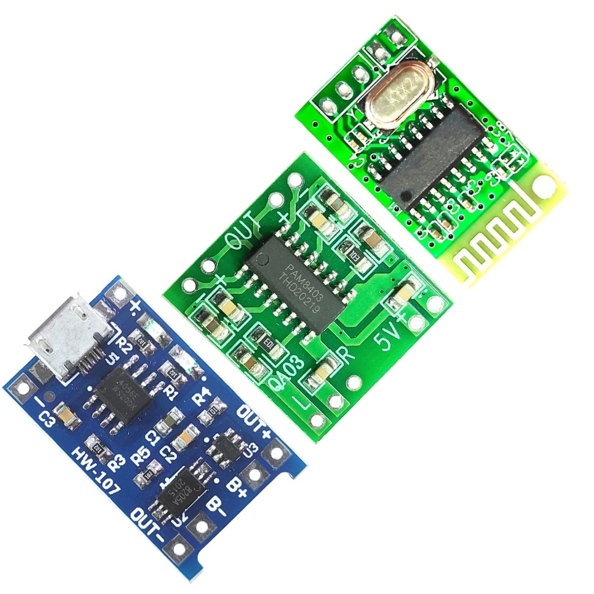
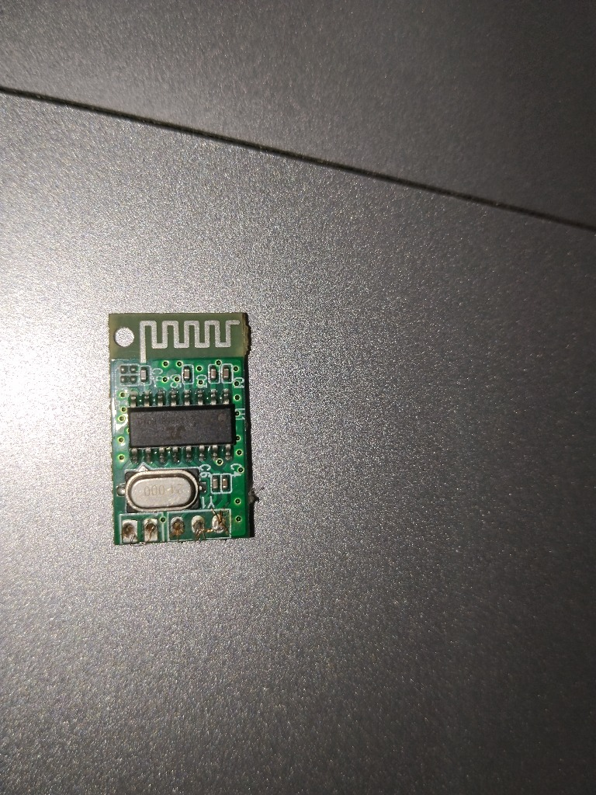
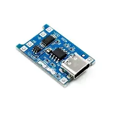
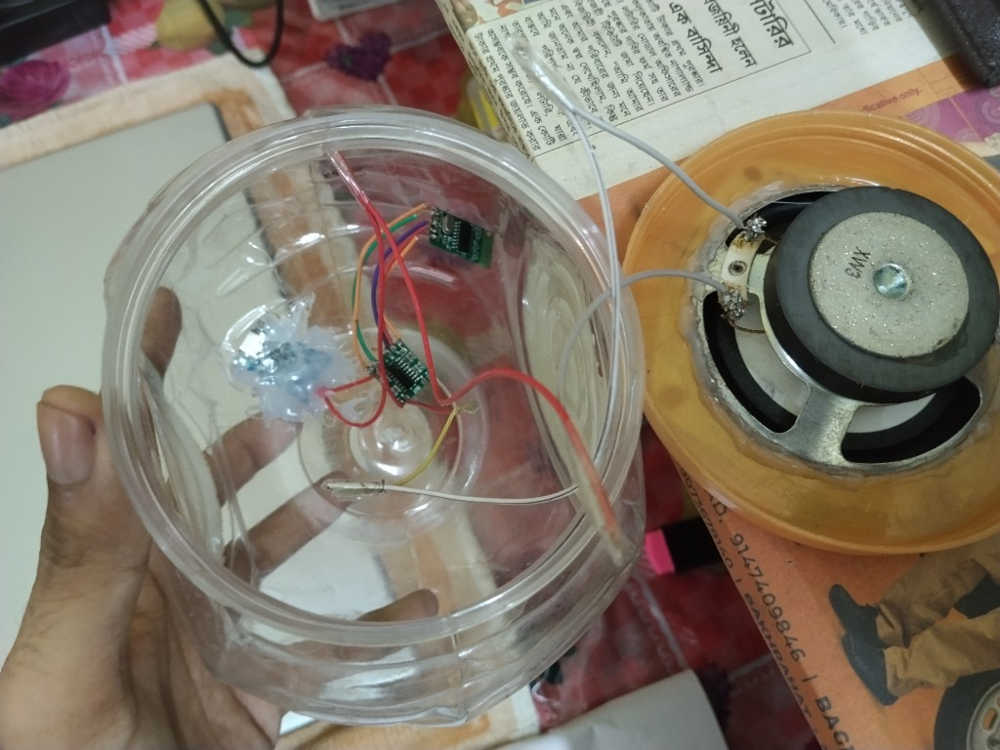
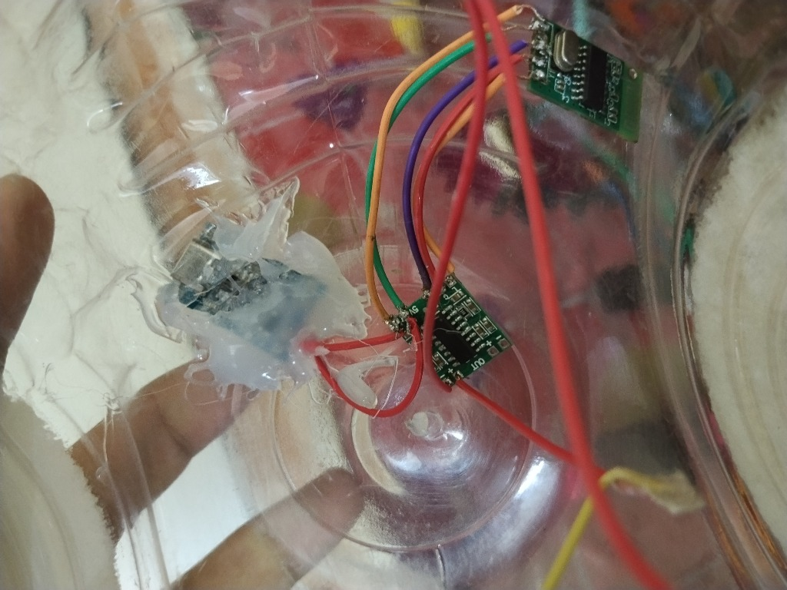

# 🔊 DIY Bluetooth Speaker — No Battery | Type-C Powered

A simple DIY Bluetooth speaker built using a **PAM8403 amplifier**, **Bluetooth audio module**, and **TP4056 charging module** — powered **directly via a Type-C USB charger** (no battery required).

> Built inside a recycled plastic container as the speaker enclosure.

---

## 🎬 Demo Video

https://github.com/dipanr705-12/bluetooth-speaker/raw/main/demo.mp4

> 🔊 Watch the speaker in action — Bluetooth connected and playing audio via Type-C power!

---

## 📸 Project Photos

### Components Used


### Bluetooth Module (Close-up)


### TP4056 Type-C Module


### Inside Assembly


### Wiring Close-up


---

## 🧰 Components List

| Component | Specification | Purpose |
|-----------|--------------|---------|
| **PAM8403** | 3W+3W Stereo Amplifier | Amplifies audio signal to speaker |
| **Bluetooth Audio Module** | XY-BT-Mini / similar | Receives audio wirelessly via Bluetooth |
| **TP4056** | Type-C, 1A Charging Module | Power input (used as 5V power source) |
| **Speaker** | 4Ω or 8Ω, 3W | Outputs the sound |
| **Plastic Container** | Recycled | Speaker enclosure / housing |
| **Wires** | Various colors | Connections |

---

## ⚡ Power Configuration (No Battery Mode)

> [!IMPORTANT]
> In this build, **no Li-ion battery is used**. The TP4056 module's **OUT+** and **OUT−** pins are used as a **direct 5V power pass-through** from the Type-C USB charger.

The TP4056 receives 5V from the Type-C port and passes it through to power the rest of the circuit.

---

## 🔌 Hardware Connection / Wiring Diagram

```
Type-C Charger (5V)
        │
        ▼
  ┌─────────────┐
  │   TP4056    │
  │  (Type-C)   │
  │  OUT+ OUT−  │
  └──┬──────┬───┘
     │      │
    5V     GND
     │      │
     ├──────┤──────────────────────────┐
     │      │                          │
     ▼      ▼                          ▼
┌──────────────────┐         ┌──────────────────┐
│  Bluetooth Audio  │         │     PAM8403      │
│     Module        │         │   Amplifier      │
│                   │         │                  │
│  VCC  GND  L  R  │         │  VCC  GND        │
└──┬────┬────┬──┬──┘         └──┬────┬──────────┘
   │    │    │  │               │    │
  5V   GND  L  R              5V   GND
              │  │
              └──┴──► Audio IN (L/R) on PAM8403
                              │
                              ▼
                       ┌──────────────┐
                       │   Speaker    │
                       │  OUT+ / OUT− │
                       └──────────────┘
```

### Detailed Pin Connections

#### TP4056 → Power Rails
| TP4056 Pin | Connect To |
|-----------|-----------|
| OUT+ | 5V Power Rail (→ BT Module VCC, PAM8403 VCC) |
| OUT− | GND Rail (→ BT Module GND, PAM8403 GND) |

#### Bluetooth Module → PAM8403
| Bluetooth Module Pin | PAM8403 Pin |
|---------------------|------------|
| VCC | 5V (from TP4056 OUT+) |
| GND | GND (from TP4056 OUT−) |
| L (Left Audio Out) | L IN+ |
| R (Right Audio Out) | R IN+ |
| GND (Audio) | L IN−, R IN− (tied together) |

#### PAM8403 → Speaker
| PAM8403 Pin | Speaker |
|------------|---------|
| L OUT+ | Speaker + (Left channel) |
| L OUT− | Speaker − (Left channel) |
| VCC | 5V (from TP4056 OUT+) |
| GND | GND (from TP4056 OUT−) |

---

## 📐 Circuit Flow

```
Type-C (5V) ──► TP4056 OUT ──► [ BT Module ] ──Audio──► PAM8403 ──► Speaker
                           └──► [ PAM8403 VCC/GND ]
```

---

## 🔧 How to Build

1. **Power Input**: Connect a 5V Type-C charger to the TP4056 module.
2. **Power Wiring**: Take 5V and GND from TP4056 OUT+ and OUT− pins.
3. **BT Module Power**: Connect 5V and GND to the Bluetooth module's VCC and GND.
4. **Audio Connection**: Wire the L and R audio output pins of the BT module to the L IN and R IN of the PAM8403.
5. **Amplifier Power**: Connect 5V and GND to PAM8403 VCC and GND.
6. **Speaker**: Connect the speaker to PAM8403 OUT+ and OUT−.
7. **Enclosure**: Mount everything inside the plastic container. Fit the speaker on the lid.
8. **Route the Type-C cable** out through a hole in the container.

---

## ⚠️ Important Notes

- **No battery** is used — the speaker only works when plugged into a USB Type-C charger.
- The TP4056 is used purely as a **power interface** (5V input → 5V output), not for battery charging.
- PAM8403 operates at 5V and delivers up to **3W per channel**.
- Keep audio ground and power ground **common** to avoid noise/hum.
- For best sound, ensure the speaker is **properly sealed** inside the enclosure.

---

## 📦 Repository Structure

```
bluetooth-speaker/
│
├── README.md               ← This file
├── images/
│   ├── components-overview.jpg
│   ├── bluetooth-module.jpg
│   ├── tp4056-module.webp
│   ├── assembly-inside.jpg
│   └── wiring-closeup.jpg
└── LICENSE
```

---

## 📄 License

This project is open-source under the [MIT License](LICENSE).

---

## 👤 Author

**Dipan Roy**  
GitHub: [@dipanr705-12](https://github.com/dipanr705-12)

---

*Feel free to fork, improve, and share! ⭐ Star this repo if you found it helpful.*
